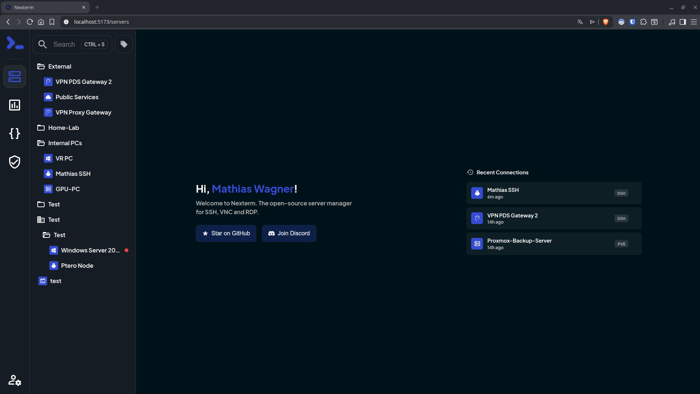
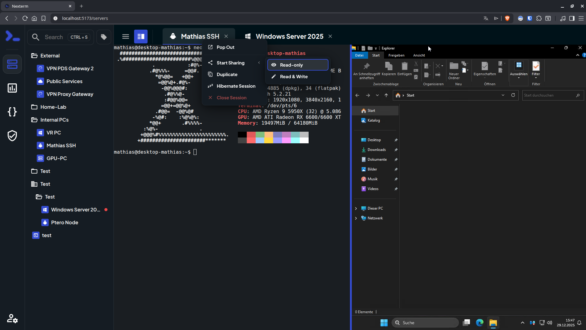
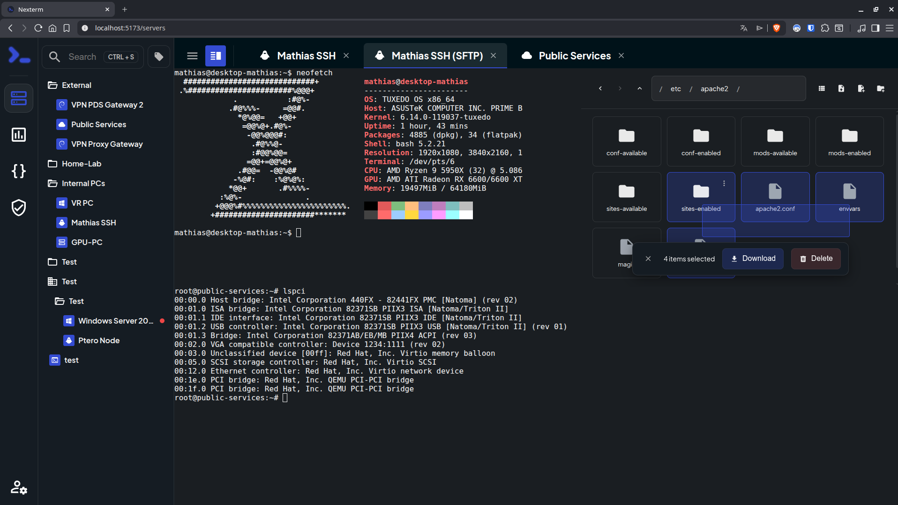
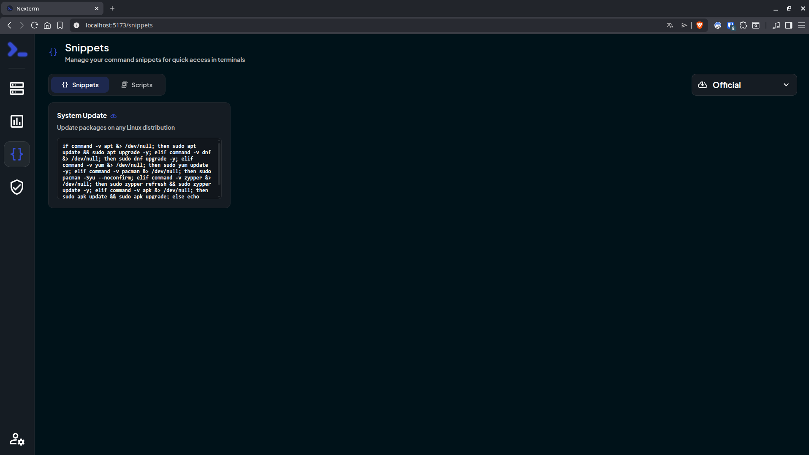
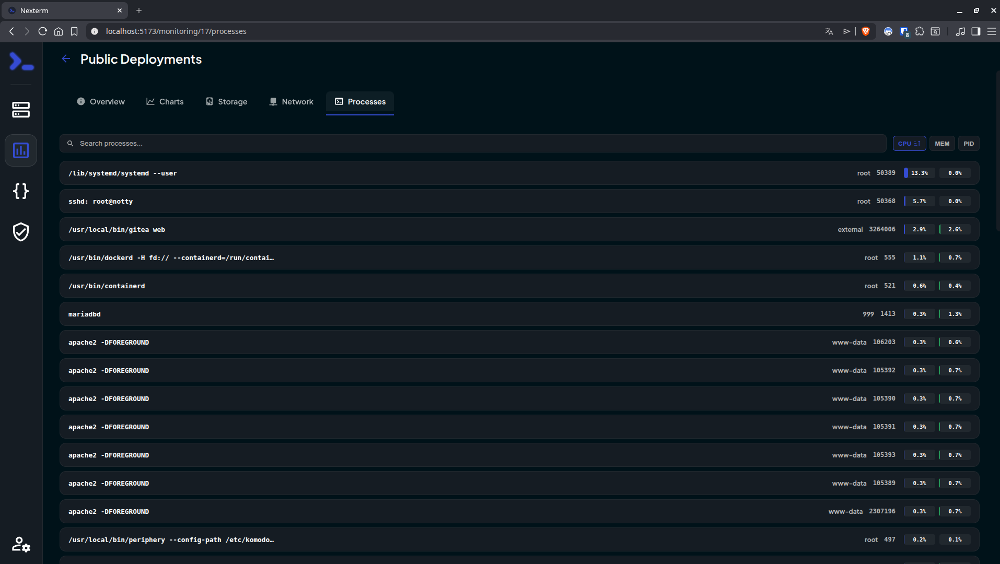
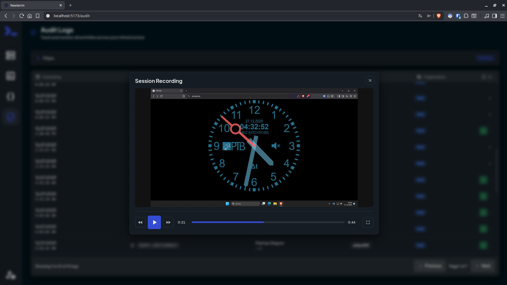

<br />
<p align="center">
  <a href="https://github.com/j-gaertig/Nexterm-Neo">
    <picture>
        <source media="(prefers-color-scheme: dark)" srcset="https://i.imgur.com/WhNYRgX.png">
        
    </picture>
  </a>
</p>

## 🆕 Nexterm Neo

Nexterm Neo is an unofficial community fork of [Nexterm](https://github.com/gnmyt/Nexterm), maintained by j-gaertig. AI tools assist with development; all changes are reviewed and maintained by j-gaertig.

This independent project focuses on features and improvements that fit my needs. It is not affiliated with or endorsed by the official Nexterm project.

## 🤔 What is Nexterm?

Nexterm is an open-source server management software that allows you to:

-   Connect remotely via SSH, VNC and RDP
-   Manage files through SFTP
-   Deploy applications via Docker
-   Manage Proxmox LXC and QEMU containers
-   Secure access with two-factor authentication and OIDC SSO
-   Separate users and servers into Organizations

## 📷 Screenshots

<table>
  <tr>
    <td></td>
    <td></td>
    <td></td>
  </tr>
  <tr>
    <td></td>
    <td></td>
    <td></td>
  </tr>
</table>

## 🚀 Install

Nexterm Neo runs as an all-in-one Docker container. Install Docker Engine with the Docker Compose plugin, then create a `.env` file next to your `compose.yaml`:

```env
ENCRYPTION_KEY=replace-this-with-a-generated-key
```

Generate a key with `openssl rand -hex 32` and put the result in `.env`. Keep this key safe and use the same key whenever you update or recreate the container.

Create `compose.yaml`:

```yaml
services:
  nexterm:
    image: ghcr.io/j-gaertig/nexterm-aio:development
    container_name: nexterm
    network_mode: host
    restart: unless-stopped
    environment:
      ENCRYPTION_KEY: ${ENCRYPTION_KEY}
    volumes:
      - nexterm:/app/data

volumes:
  nexterm:
```

Make sure the `nexterm-aio` package on GitHub Container Registry is public, then start Nexterm:

```sh
docker compose up -d
```

Open `http://<server-ip>:6989` in your browser. With host networking, Nexterm can access the host network directly, which is useful for connections to `localhost` and Wake-on-LAN.

### Update an existing Nexterm installation

Change only the `image` value in your existing Compose file:

```yaml
image: ghcr.io/j-gaertig/nexterm-aio:development
```

Keep your existing `/app/data` volume and `ENCRYPTION_KEY`. Pull the new image and recreate the Nexterm container:

```sh
docker compose pull nexterm
docker compose up -d nexterm
```

## 🔧 Configuration

### Docker Images

| Image                                 | Description                                              |
|---------------------------------------|----------------------------------------------------------|
| `ghcr.io/j-gaertig/nexterm-aio`       | All-In-One — server, client, and engine bundled together |
| `ghcr.io/j-gaertig/nexterm-server`    | Server + web client only (requires external engine)      |
| `ghcr.io/j-gaertig/nexterm-engine`    | Engine only                                              |

The server listens on port 6989 by default. You can modify this behavior using environment variables:

- `SERVER_PORT`: Server listening port (default: 6989)
- `CONTROL_PLANE_PORT`: TCP port for engine communication (default: 7800)
- `NODE_ENV`: Runtime environment (development/production)
- `ENCRYPTION_KEY`: Encryption key for passwords, SSH keys and passphrases. Supports Docker secrets via
  /run/secrets/encryption_key`
- `AI_SYSTEM_PROMPT`: Extra instructions appended to the AI assistant's system prompt (example: Always explain destructive commands before running them.)
- `LOG_LEVEL`: Logging level for application and engine (system/info/verbose/debug/warn/error, default: system)
- `TRUST_PROXY`: Number of reverse proxies in front of Nexterm, so logs and audits show the real client IP instead of the
  proxy's (default: disabled). Use `1` for a single Nginx/Traefik, or pass trusted addresses (`10.10.10.10,192.168.0.0/16`).
  Only enable this if your proxy sets `X-Forwarded-For`, otherwise clients can spoof their IP.

## 🛡️ Security

-   Two-factor authentication
-   Session management
-   Password encryption
-   Docker container isolation
-   Oauth 2.0 OpenID Connect SSO

## 🤝 Contributing

Contributions are welcome! Please feel free to:

1. Fork the project
2. Create a feature branch (`git checkout -b feature/AmazingFeature`)
3. Commit your changes (`git commit -m 'Add some AmazingFeature'`)
4. Push to the branch (`git push origin feature/AmazingFeature`)
5. Open a Pull Request

## 🔗 Useful Links

-   [Report a bug](https://github.com/j-gaertig/Nexterm-Neo/issues)
-   [Request a feature](https://github.com/j-gaertig/Nexterm-Neo/issues)

## 📜 License

Distributed under the MIT license. See `LICENSE` for more information.
